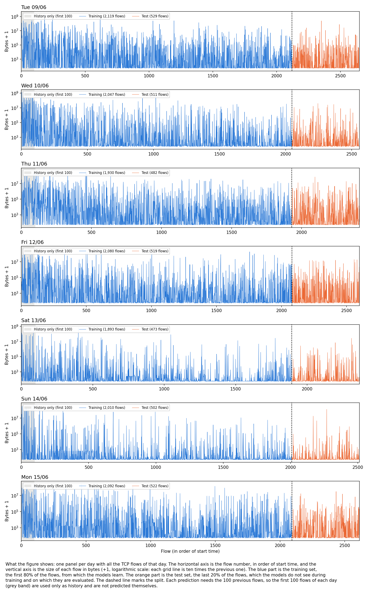
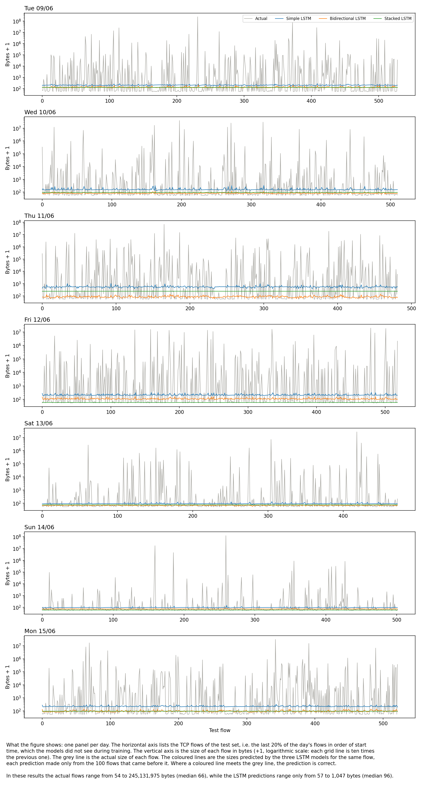
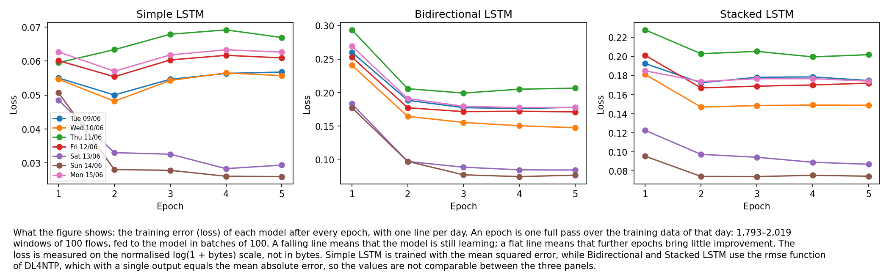

# Results of the LSTM prediction

This folder holds the output of [`DL4NTP.ipynb`](../DL4NTP.ipynb). The notebook handles each of the 7 days separately: it trains three LSTM networks on the first 80% of the day's TCP flows, in order of start time, and tests them on the last 20%. For each test flow, the models predict its bytes within the first minute of the trace from the 100 flows that came before it. Four simple baselines are evaluated on the same test flows for comparison. The main [README](../../README.md) describes the whole project.

## Files

| File | Content |
|---|---|
| `week_lstm.csv` | MAE, RMSE, R² and MAE log10 of every model on every day (49 rows) |
| `week_lstm_summary.csv` | the same metrics averaged over the 7 days, one row per model |
| `week_lstm_split.png` | all TCP flows of each day, with the training part and the test part |
| `week_lstm_predictions.png` | actual and predicted bytes of the test flows, the three LSTMs together |
| `week_lstm_predictions_simple.png`, `_bidirectional.png`, `_stacked.png` | the same for one LSTM at a time |
| `week_lstm_loss.png` | training loss per epoch, for each model and day |

## The models

- **Simple LSTM**, **Bidirectional LSTM**, **Stacked LSTM**: the three neural networks, each trained on the first 80% of the day's TCP flows.
- **Previous flow**: predicts that each flow is as large as the flow before it.
- **Median of previous 100 flows**: predicts the median size of the 100 flows before it.
- **Train median**: always predicts the median size of the training flows.
- **Always 0 bytes**: always predicts 0. It learns nothing and is there only as a check on the metrics.

## The metrics

| Metric | Meaning |
|---|---|
| MAE | mean absolute error in bytes: on average, how many bytes the prediction is off for each test flow |
| RMSE | root mean squared error in bytes: like MAE, but each error is squared first, so large errors count much more |
| R² | coefficient of determination: 1 is a perfect prediction, 0 is no better than the mean of the test flows, below 0 is worse than that |
| MAE log10 | mean error in orders of magnitude: 0.3 is about two times off, 1 is ten times off, 2 is a hundred times off; every flow counts the same, small or large |

In the CSV files the numbers are written with full precision and a dot as the decimal separator. For example, `852518.911153119` is 852,519 bytes, about 0.85 MB.

## Mean of the 7 days (`week_lstm_summary.csv`)

| Model | MAE (bytes) | RMSE (bytes) | R² | MAE log10 |
|---|---|---|---|---|
| Previous flow | 747,781 | 5,746,641 | -1.022 | 1.152 |
| Median of previous 100 flows | 377,243 | 4,066,284 | -0.013 | 0.816 |
| Train median | 377,249 | 4,066,278 | -0.013 | 0.826 |
| Always 0 bytes | 377,300 | 4,066,296 | -0.013 | 2.588 |
| Simple LSTM | 377,263 | 4,066,270 | -0.013 | 0.870 |
| Bidirectional LSTM | 377,243 | 4,066,285 | -0.013 | 0.822 |
| Stacked LSTM | 377,243 | 4,066,284 | -0.013 | 0.824 |

## What the results of each day show (`week_lstm.csv`)

Each row of `week_lstm.csv` is one model on one day: 7 days × 7 models = 49 rows. The test part of each day has 473–529 flows.

1. **MAE and RMSE in bytes hardly separate the models.** On each day, all models except Previous flow are within 56–60 bytes of each other in MAE. Their MAE is about the mean size of the test flows of that day (for Always 0 bytes it is exactly that), which is why it changes so much from day to day: from 108,417 bytes on Saturday to 852,572 on Tuesday. It depends on how many of the few very large flows fall in the test part. RMSE is 6–19 times larger than MAE for the same reason.

2. **Previous flow is about twice as bad.** Its MAE is 1.96–2.00 times the best MAE of the day and its R² is about −1 (−1.006 to −1.038) on every day. Since a flow is almost unrelated to the one before it, copying the previous flow is even worse than always predicting 0 bytes.

3. **R² is slightly below 0 for all other models** (−0.003 to −0.032), so none of them does better than the mean of the test flows.

4. **MAE log10 is where the models differ.**
   - Always 0 bytes: 2.10–2.92, i.e. about 125 to 840 times off.
   - All the other models except Previous flow: 0.34–1.19.
   - The best model of each day is an LSTM on three days (Stacked on Tuesday and Thursday, Bidirectional on Monday) and one of the median baselines on the other four. Bidirectional and Stacked LSTM are always within 0.025 of the median of the previous 100 flows.
   - Simple LSTM is the weakest LSTM, and worse than the training median, on every day.
   - The weekend is easier (0.34–0.56) than the weekdays (0.73–1.19), because on Saturday and Sunday most TCP flows are small and alike.

**Why there is an "Always 0 bytes" row.** A small example with five flows of 60, 60, 80, 100 and 1,000,000 bytes, many small flows and one very large one as in the real data:

| Prediction for every flow | Error per flow (bytes) | MAE (bytes) | MAE log10 |
|---|---|---|---|
| Always 0 bytes | 60, 60, 80, 100, 1,000,000 | 200,060 | 2.70 |
| Always 70 bytes | 10, 10, 10, 30, 999,930 | 199,998 | 0.90 |

The second prediction is almost right for four of the five flows and the first for none, yet their MAE in bytes is almost the same, because the one very large flow decides it. So the MAE in bytes cannot show whether a model has learned anything, while MAE log10 can.

## The figures

### Training and test flows (`week_lstm_split.png`)

One panel per day: the flows in order of start time, blue for training and orange for test, with the split at the dashed line. The first 100 flows (grey band) serve only as history for the first predictions.

The two parts are not alike. Almost all of the very largest flows are in the training part: of the 1% largest flows of each day (24–27 flows), the test part has at most one. The largest training flow of each day is 276 MB to 2.2 GB, against 19 to 245 MB in the test part. This is most likely because the flows that were already in progress when the trace started, many of them long transfers, are seen first. All models, including the baselines, are tested on the same test flows, so the comparison between them is not affected.

### Predictions (`week_lstm_predictions*.png`)

The grey line is the actual size of each test flow and the coloured lines are the predictions of the three LSTMs. The actual flows range from 54 bytes to 245 MB, while the predictions stay between 57 and 1,047 bytes, so the coloured lines are almost flat. The models predict a typical small flow and miss every large one. The files `week_lstm_predictions_simple.png`, `_bidirectional.png` and `_stacked.png` show each LSTM alone, with its daily MAE in the title next to that of the training median and of always predicting 0 bytes.

### Training loss (`week_lstm_loss.png`)

The training error after each of the 5 epochs, one line per day. The loss of Bidirectional and Stacked LSTM falls mainly from the first to the second epoch and then stays almost flat, so more epochs would bring little. The loss of Simple LSTM falls only on the weekend; on the weekdays it ends at the same level as after the first epoch or slightly higher. Simple LSTM is trained with the mean squared error and the other two with the mean absolute error, so the values cannot be compared between the three panels.

## In short

The LSTMs learn the typical size of a flow and do as well as a simple median of the previous flows, but no better. They cannot predict which flows will be very large, because the size of a flow is almost unrelated to the flows that came before it.
