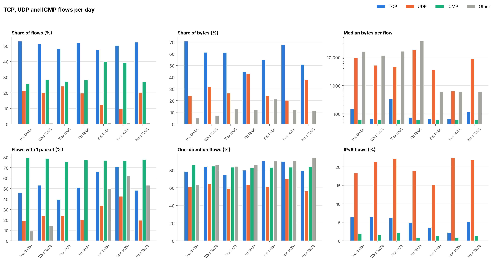

# StreamingAnalysis

Code, data and results for a bachelor's thesis on **knowledge extraction from network traffic flows using data mining techniques**.

The project has three parts:

1. **Dataset:** flows are extracted from public packet traces of the MAWI archive.
2. **Analysis:** TCP, UDP and ICMP flows are analysed separately for each day, and the days are then compared.
3. **Prediction:** LSTM networks predict the total size in bytes of each TCP flow from the flows that came before it.



## Dataset

The flows come from the [MAWI Working Group Traffic Archive](https://mawi.wide.ad.jp/mawi/) of the WIDE project, **samplepoint-F**. This sampling point monitors the transit link of WIDE in Tokyo and, since 2023, also the link to the BBIX exchange point. Each daily trace covers 15 minutes, from 14:00 to 14:15 Japan time. IP addresses are anonymised with Crypto-PAn, and the mapping is consistent only within one daily trace, so the same address on two different days is not necessarily the same host.

**Sample:**
- 7 consecutive days, from Tuesday 9 to Monday 15 June 2026 (five weekdays and one weekend).
- Only the first minute of each trace is used (14:00–14:01).
- From that minute, the first **5,000 flows** to start are kept, whatever their protocol, so the dataset has **35,000 flows** in total.

| Date | Day | Flow starts (ms) | Packets | Volume (GB) | IPv4 / IPv6 (%) |
|---|---|---|---|---|---|
| 09/06/2026 | Tuesday | 0–29.6 | 8,625,150 | 13.29 | 92.2 / 7.7 |
| 10/06/2026 | Wednesday | 0–33.3 | 9,739,992 | 14.25 | 91.8 / 8.0 |
| 11/06/2026 | Thursday | 0–33.4 | 6,657,689 | 7.87 | 90.8 / 8.9 |
| 12/06/2026 | Friday | 0–29.3 | 7,725,432 | 9.45 | 93.3 / 6.5 |
| 13/06/2026 | Saturday | 0–42.4 | 4,055,512 | 4.30 | 95.7 / 4.1 |
| 14/06/2026 | Sunday | 0–45.2 | 4,041,152 | 4.85 | 96.1 / 3.6 |
| 15/06/2026 | Monday | 0–33.5 | 6,713,875 | 8.66 | 92.3 / 7.4 |
| **Total** | | | **47,558,802** | **62.67** | |

Packets and volume count the packets of the 5,000 flows within the first minute of each trace.

## Repository structure

```
StreamingAnalysis/
├── pcap_first_flows.py        # MAWI pcap -> CSV with the first N flows (all protocols)
├── analysis.py                # statistical analysis per protocol and day, comparison of days
├── Conversations/             # the dataset: one CSV per day
│   ├── first_5000_flows_20260609.csv
│   ├── first_5000_flows_20260609.png   # flows, packets and bytes per protocol for that day
│   └── ...                             # same for 10/06 - 15/06
├── Results/                   # output of analysis.py
│   ├── week_protocols.csv / .png       # protocol mix per day
│   ├── TCP/
│   │   ├── 20260609/ ... 20260615/     # analysis of each day
│   │   └── week_*                      # comparison of the 7 days
│   ├── UDP/                            # same structure
│   └── ICMP/                           # same structure (ICMP and ICMPv6)
└── DL4NTP/
    └── DL4NTP.ipynb           # LSTM models (Simple, Bidirectional, Stacked)
```

## 1. Flow extraction: `pcap_first_flows.py`

The script reads a MAWI trace with `tshark` and keeps the first N flows (default 5,000), whatever their protocol. It writes them to a CSV file and draws a PNG with the protocol mix.

```bash
python3 pcap_first_flows.py 202606091400.pcap.gz first_5000_flows_20260609.csv --until 60
```

- `--n`: number of flows to keep (default 5000)
- `--until`: stop reading after this many seconds (60 = first minute)
- `--png`: name of the PNG file (default: same name as the CSV)

**How a flow is defined:**
- **TCP:** one flow per connection (`tcp.stream`), as in Wireshark's *Statistics → Conversations → TCP*.
- **UDP:** one flow per `udp.stream`, i.e. per pair of addresses and ports.
- **Protocols without ports (ICMP, ICMPv6, GRE, ESP, tunnels):** one flow per pair of IP addresses and protocol.
- **Non-IP traffic (e.g. ARP):** one flow per pair of MAC addresses and protocol.

The outer header decides the protocol. An ICMP error that carries a TCP header counts as ICMP, and a tunnel counts as one flow.

The "first N flows" are the N flows that start first. All their packets are counted until the end of the file, or until `--until`, so every flow kept is complete within the window. Packet size is the original frame length (`frame.len`).

**Columns:** `Network, Protocol, Address A, Port A, Address B, Port B, Packets, Bytes, Stream ID, Packets A → B, Bytes A → B, Packets B → A, Bytes B → A, Rel Start, Duration, Bits/s A → B, Bits/s B → A`

- A is the source of the flow's first packet.
- `Rel Start` is measured in seconds from the start of the trace.
- `Bits/s` is left empty when `Duration` < 5 ms, as in Wireshark.
- Rows are sorted by `Rel Start`.

## 2. Analysis: `analysis.py`

Run it on all seven days:

```bash
python3 analysis.py Conversations/first_5000_flows_*.csv
```

Or run it on a single day:

```bash
python3 analysis.py Conversations/first_5000_flows_20260609.csv
```

Each protocol group (TCP, UDP, ICMP) is analysed separately. The target variable is `Bytes`, the total size of a flow.

**Per day** (`Results/<protocol>/<date>/<date>_*`):

| File | Content |
|---|---|
| `describe.csv`, `statistics.csv` | descriptive statistics of the flow features |
| `DistributionOfDatasetColumns.png` | distributions of the flow features |
| `correlation.csv`, `correlation_analysis.png` | Spearman correlation between the features of the same flow (redundant inputs) |
| `lag_correlation.csv`, `lag_correlation.png` | Spearman correlation of each feature of flow *t* with the bytes of flow *t+k* (k = 0, 1, 10, 100) |
| `autocorrelation.csv`, `autocorrelation.png` | autocorrelation of the flow sizes |
| `TimeSeries.png`, `per_0.1s.csv` | traffic aggregated per 0.1 s |
| `baselines.csv` | MAE and RMSE of simple baselines on the last 20% of the flows (the models the LSTM must beat) |
| `summary.csv` | summary of the day |

**Comparison of the 7 days** (`Results/<protocol>/week_*`):

| File | Content |
|---|---|
| `week_summary.csv` | key figures per day, with weekday and weekend means |
| `week_by_day.png`, `week_distributions.png` | the days side by side |
| `week_similarity_ks.csv`, `week_similarity.png` | Kolmogorov–Smirnov distance between the byte distributions of each pair of days |
| `week_weekday_vs_weekend.csv` | weekdays compared with the weekend |
| `week_heavy_hitters.csv`, `week_heavy_hitters.png`, `week_top_pairs.csv` | the largest flows and the address pairs behind them |
| `week_baselines.csv` | baselines under different train/test splits by day |

The protocol mix of all days is written to `Results/week_protocols.csv` and `Results/week_protocols.png`.

## 3. Prediction: `DL4NTP/DL4NTP.ipynb`

The notebook is based on the code of Fleischer & Myerson (link below). It compares three architectures: **Simple LSTM**, **Bidirectional LSTM** and **Stacked LSTM**.

- **Input:** only the TCP flows, sorted by start time, with each flow as one step of the sequence.
- **Output:** the total bytes of the next flow.
- **Evaluation:** MAE and RMSE, compared with the baselines from `analysis.py`.

> The notebook is being adapted to the MAWI TCP flows in `Conversations/`.

## Requirements

- Python 3 with `pandas`, `numpy`, `scipy`, `scikit-learn`, `matplotlib`, `seaborn`
- `tshark` (part of Wireshark) for `pcap_first_flows.py`
- `tensorflow` / `keras` for the LSTM notebook

```bash
pip install pandas numpy scipy scikit-learn matplotlib seaborn tensorflow
```

## Data source

- MAWI Working Group Traffic Archive: https://mawi.wide.ad.jp/mawi/
- samplepoint-F traces of 2026: https://mawi.wide.ad.jp/mawi/samplepoint-F/2026/
- K. Cho, K. Mitsuya, A. Kato, *Traffic Data Repository at the WIDE Project*, USENIX Annual Technical Conference, FREENIX Track, 2000.

## Links
* [https://github.com/nb0309/Network-Traffic-Analysis-using-Machine-learning/blob/main/anomalydetection.ipynb](https://github.com/nb0309/Network-Traffic-Analysis-using-Machine-learning/blob/main/anomalydetection.ipynb)
* [https://github.com/shikhar-srivastava/Network-Traffic-Classification](https://github.com/shikhar-srivastava/Network-Traffic-Classification)
* [https://github.com/biagiom/spark-network-traffic-classifier](https://github.com/biagiom/spark-network-traffic-classifier)
* [https://github.com/fle1scha/Deep-Learning-Network-Traffic-Prediction](https://github.com/fle1scha/Deep-Learning-Network-Traffic-Prediction)
