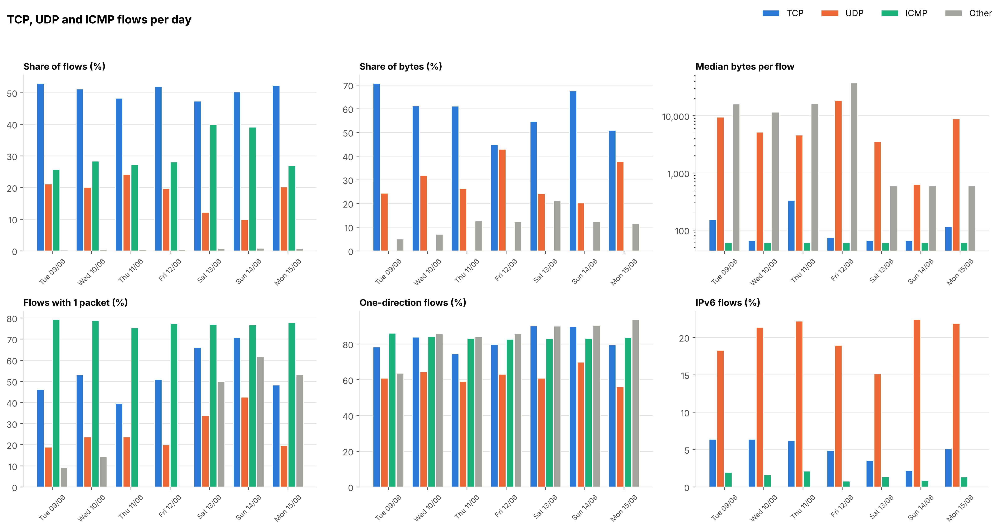
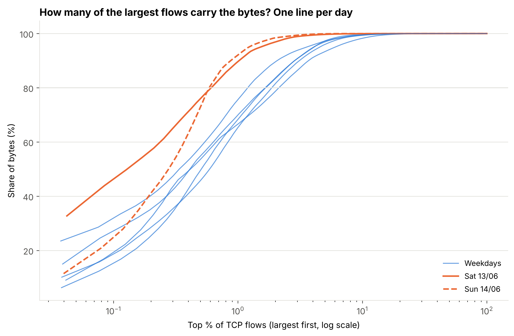
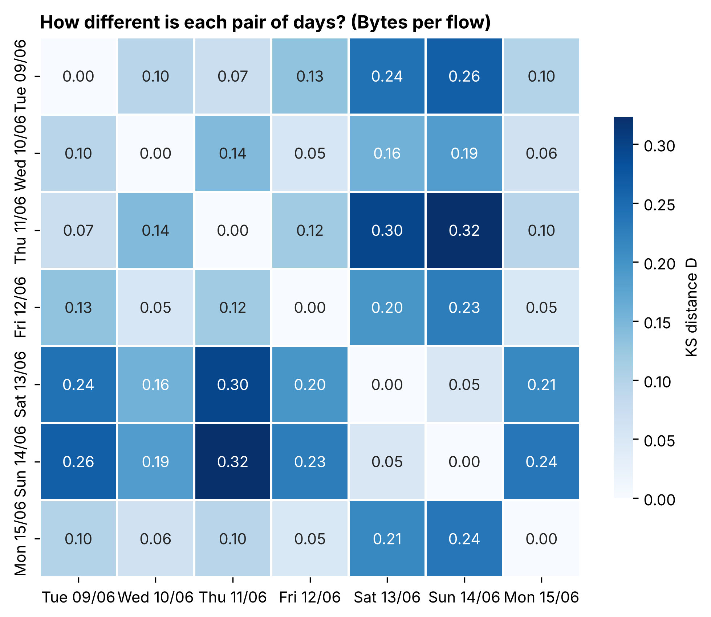

# Results of the analysis

This folder holds the output of [`analysis.py`](../analysis.py), run on the seven daily flow files of [`Conversations/`](../Conversations) (9–15 June 2026, 5,000 flows per day from the MAWI archive). Each protocol group is analysed separately for each day, and the days are then compared:

- **TCP**
- **UDP**
- **ICMP** (ICMP and ICMPv6 together)

The variable studied is `Bytes`, the bytes of a flow within the first minute of the trace. The main [README](../README.md) describes the whole project, and the LSTM prediction is in [`DL4NTP/Results Prediction/`](../DL4NTP/Results%20Prediction).

## Structure

```
Results/
├── week_protocols.csv / .png     # protocol mix of each day
├── TCP/
│   ├── 20260609/ ... 20260615/   # analysis of each day
│   └── week_*                    # comparison of the 7 days
├── UDP/                          # same structure
└── ICMP/                         # same structure
```

## Files of each day (`<protocol>/<date>/<date>_*`)

| File | Content |
|---|---|
| `describe.csv`, `statistics.csv` | descriptive statistics of the flow fields (mean, median, standard deviation, percentiles, skewness, kurtosis) |
| `DistributionOfDatasetColumns.png` | histogram of each field |
| `correlation.csv`, `correlation_analysis.png` | Spearman correlation between the fields of the same flow |
| `lag_correlation.csv`, `lag_correlation.png` | Spearman correlation of each field of a flow with the bytes of the flow 1, 10 and 100 places later |
| `autocorrelation.csv`, `autocorrelation.png` | autocorrelation of the flow sizes, in order of start time |
| `TimeSeries.png`, `per_0.1s.csv` | the bytes of each flow in order of start time, and the traffic per 0.1 s |
| `baselines.csv` | error (MAE, RMSE) of simple predictions on the last 20% of the flows |
| `summary.csv` | the key figures of the day in one table |

In `describe.csv` the ports and `Stream ID` are identifiers, not measurements, so their statistics have no meaning.

**Note on the time-based outputs:** all the flows of a day start within the first 29–45 ms of the trace, so the traffic per 0.1 s has a single interval. As a result `per_0.1s.csv` has one row, the per-0.1 s values in `autocorrelation.csv` and `summary.csv` are empty, and only the upper panel of `TimeSeries.png` (the bytes of each flow) is meaningful. In the same way, `New flows per second` in `summary.csv` is the rate at which flows are first seen in those few milliseconds, not the rate at which new connections arrive.

## Files comparing the 7 days (`<protocol>/week_*`)

| File | Content |
|---|---|
| `week_summary.csv` | the key figures of each day side by side, with the weekday and weekend means |
| `week_by_day.png` | six of those figures as bar charts, one bar per day |
| `week_distributions.png` | the distribution of `Bytes` of each day (cumulative curve and box plot) |
| `week_similarity_ks.csv`, `week_similarity.png` | Kolmogorov–Smirnov distance between the `Bytes` distributions of each pair of days |
| `week_weekday_vs_weekend.csv` | weekdays compared with the weekend |
| `week_heavy_hitters.csv`, `week_heavy_hitters.png` | how much of the traffic the largest flows carry |
| `week_top_pairs.csv` | the 10 pairs of addresses with the most bytes on each day |
| `week_baselines.csv` | error of simple predictions, with the median taken from the same day or from other days |

## How to read the numbers

| Term | Meaning |
|---|---|
| Spearman correlation | how strongly two quantities rise together, from −1 to 1; 0 means no relation. It uses the order of the values, so a few huge flows do not dominate it |
| Autocorrelation (ACF) at lag k | the correlation of the series with itself shifted by k flows; values near 0 mean that a flow says almost nothing about the flows that follow |
| Kolmogorov–Smirnov distance (KS D) | how different two distributions are, from 0 (identical) to 1 (completely different) |
| MAE | mean absolute error in bytes of a prediction |

In the CSV files the numbers are written with full precision and a dot as the decimal separator. For example, `852518.911153119` is 852,519 bytes, about 0.85 MB.

## What the results show

### 1. The three protocols carry very different traffic (`week_protocols.csv`)



Mean of the 7 days:

| Protocol | Flows (%) | Packets (%) | Bytes (%) | Median bytes per flow | Flows with 1 packet (%) | One-direction flows (%) | Median duration (s) | IPv6 flows (%) |
|---|---|---|---|---|---|---|---|---|
| TCP | 50.6 | 40.1 | 58.7 | 125 | 53.5 | 82.3 | 0.20 | 5.0 |
| UDP | 18.2 | 45.1 | 29.6 | 7,249 | 26.0 | 62.1 | 26.2 | 20.0 |
| ICMP | 30.8 | 0.2 | 0.01 | 60 | 77.5 | 83.7 | 0.00 | 1.4 |
| Other | 0.5 | 14.6 | 11.7 | 11,859 | 26.9 | 84.8 | 34.5 | 0.0 |

- **TCP** has half of the flows and most of the bytes, but most TCP flows are tiny: half of them have a single packet and the median duration is 0.2 s.
- **UDP** has fewer flows but larger and longer ones: median about 7,200 bytes and 26 s. One UDP flow in five is IPv6.
- **ICMP** has almost a third of the flows but almost no bytes: small messages of 60 bytes, mostly a single packet.
- **Other** (GRE and ESP tunnels, ARP, IP fragments) has under 1% of the flows but 5–21% of the bytes, because a tunnel counts as one flow.

### 2. A few flows carry almost all the bytes (`week_heavy_hitters.csv`)



- In TCP, the largest 1% of the flows carries 64–92% of the bytes of each day, and the largest 10% carries over 98%. Just 15–52 flows (0.6–2.2% of the day's TCP flows) carry 80% of the bytes.
- These large TCP flows last practically the whole minute (median duration 59.3–60 s) and have a median of 41–162 MB. The other flows have a median duration of 0 to 1 s.
- The pair of addresses with the most TCP bytes carries 7–38% of the day's TCP bytes, and the top 10 pairs carry 47–76% (`week_top_pairs.csv`).
- The concentration is weaker but still large in UDP (largest 1%: 31–73% of the bytes) and in ICMP (36–67%).

### 3. The fields of the same flow are strongly related (`correlation.csv`)

Packets and bytes of the same flow have a Spearman correlation of 0.82–0.96 in TCP, 0.94–0.97 in UDP and 0.96–0.98 in ICMP. In TCP and UDP about half of all pairs of fields have a correlation of 0.8 or more, so they give almost the same information. The fields of the B → A direction are the least related to the rest (about 0.3–0.5 on average), so they add information of their own. This is why the prediction notebook keeps only three fields: `Bytes`, `Bytes B → A` and `Duration`.

### 4. The weekend differs from the weekdays in TCP and UDP, but not in ICMP (`week_weekday_vs_weekend.csv`)



- **TCP:** on Saturday and Sunday the flows are smaller (median 66 bytes against 132) and more often have a single packet (68% against 48%), and the largest 1% carries a larger share of the bytes (about 91% against 69%). Two weekdays differ by a KS distance of 0.09 on average, while a weekday and a weekend day differ by 0.23.
- **UDP:** the weekend has about half as many UDP flows (491–608 against 982–1,208) and much smaller ones (median 1,187 bytes against 8,304). KS distance 0.09 between weekdays, 0.19 between a weekday and a weekend day.
- **ICMP:** the weekend has more ICMP flows (about 39% of all flows against 26–28%), but their sizes have the same distribution as on the weekdays (KS distance 0.02–0.03, p = 0.94).

With thousands of flows, even small differences give p-values close to 0. That is why the KS distances are compared: a weekday-to-weekend distance far above the weekday-to-weekday one shows a real difference.

### 5. A flow says almost nothing about the next ones (`lag_correlation.csv`, `autocorrelation.csv`)

| Protocol | Spearman, bytes of a flow and of the next one | Autocorrelation, lag 1 | Autocorrelation, lag 100 |
|---|---|---|---|
| TCP | 0.03 to 0.07 | 0.02 to 0.10 | 0.02 to 0.08 |
| UDP | 0.00 to 0.16 | 0.00 to 0.19 | −0.02 to 0.12 |
| ICMP | 0.02 to 0.13 | 0.04 to 0.22 | −0.03 to 0.00 |

All values are close to 0, so the size of a flow is almost unrelated to the size of the flows before it. This already shows that predicting a flow from the previous flows will be very hard, which is what the LSTM prediction later confirms.

### 6. The best simple prediction is the median (`week_baselines.csv`)

Mean MAE of the 7 days on the last 20% of each day's flows, in bytes:

| Prediction | TCP | UDP | ICMP |
|---|---|---|---|
| Previous flow | 747,781 | 1,412,101 | 775 |
| Mean of the previous 100 flows | 713,217 | 1,300,634 | 809 |
| Median of the previous 100 flows | 377,243 | 739,359 | 430 |
| Median of the first 80% of the same day | 377,249 | 741,564 | 430 |
| Median of all the other days | 377,242 | 740,570 | 430 |

- A median is always the best simple prediction, with about half the error of the previous flow or of the mean. The mean is pulled up by the few huge flows.
- The median of the other days is as good as the median of the same day, so the typical flow size is similar from day to day.
- These are the baselines that the LSTMs have to beat in [`DL4NTP/Results Prediction/`](../DL4NTP/Results%20Prediction).

## In short

- TCP, UDP and ICMP carry very different kinds of traffic.
- In every protocol, a few large flows carry most of the bytes.
- The fields of the same flow largely repeat the same information.
- The weekend has less and smaller TCP and UDP traffic.
- Consecutive flows are almost unrelated, so the size of a flow cannot be predicted well from the flows before it.
